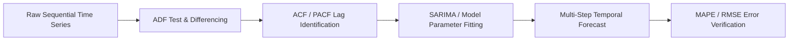

# Time Series Forecasting and Temporal Analysis Suite

> Statistical and neural time series analysis pipeline modeling seasonal trends and predicting future steps.

[](https://github.com/sohailahmed-bsrh/time-series-forecasting-pipeline)
[](https://sohail.devsil.com/projects.html)
[](https://sohail.devsil.com)

---

## Overview

Sequential data exhibits autocorrelation, seasonal variance, and non-stationarity that violate standard regression assumptions.

This project provides an end-to-end, reproducible implementation engineered to solve this challenge through verified data transformations, robust algorithms, and production-ready architecture.

---

## Key Features

- Augmented Dickey-Fuller (ADF) stationarity testing and seasonal differencing
- Autocorrelation (ACF) and Partial Autocorrelation (PACF) parameter selection
- Statistical forecasting via ARIMA/SARIMA models alongside baseline moving averages
- Mean Absolute Percentage Error (MAPE) performance benchmarking across multi-step horizons

---

## System Architecture



---

## Technology Stack

| Technology | Version / Spec | Role in Architecture |
| :--- | :--- | :--- |
| **Statsmodels** | `0.14+` | ARIMA modeling, seasonal decomposition, and ADF testing |
| **Pandas** | `2.0+` | Datetime indexing, resample intervals, and rolling windows |
| **Matplotlib** | `3.7+` | Forecast curve plots with confidence bands |

---

## Repository Structure

```text
time-series-forecasting-pipeline/
|-- notebooks/
|   `-- time_series_forcasting.ipynb
|-- data/
|-- .gitignore
|-- requirements.txt
`-- README.md
```

---

## Installation and Execution

### Prerequisites
- Python 3.10 or higher
- Git version control
- Virtual environment manager (`venv`)

### Setup Instructions
1. Clone the repository:
```bash
git clone https://github.com/sohailahmed-bsrh/time-series-forecasting-pipeline.git
cd time-series-forecasting-pipeline
```

2. Configure environment and dependencies:
```bash
python -m venv venv
source venv/bin/activate  # On Windows: venv\Scripts\activate
pip install -r requirements.txt
jupyter notebook notebooks/
```

---

## Interface and Verification
The system produces verifiable execution logs, prediction matrices, or interactive browser interfaces depending on the target mode. Verify operation by executing the commands specified above or inspecting the demonstration notebooks.

---

## Author and Contact
Developed by **Sohail Ahmed** — Full Stack AI Engineer & Machine Learning Specialist.
- **Portfolio:** [sohail.devsil.com](https://sohail.devsil.com)
- **GitHub:** [@sohailahmed-bsrh](https://github.com/sohailahmed-bsrh)
- **Email:** [sohail.bsrh@gmail.com](mailto:sohail.bsrh@gmail.com)
